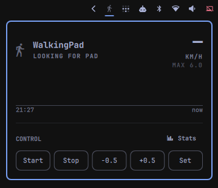
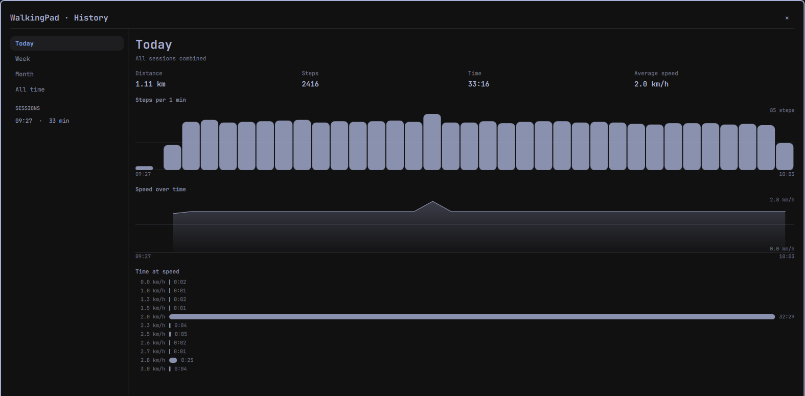

# WalkingPad Control

Control a KingSmith WalkingPad from the Omarchy bar over Bluetooth LE. No vendor
app, no account, no network access.

## Features

- **A bar icon and popup** that start and stop the belt, step the speed, set an
  exact speed, and show distance, steps and elapsed time.
- **A live chart** in the popup: steps per minute over the last 60 wall-clock
  minutes.
- **An analysis window** that browses the full history by day, week, month or all
  time, and opens any single walk on its own charts.
- **A private history** on disk that never leaves the machine, with
  `walkingpad-stats` to query it as JSON.
- **`walkingpad-bridge`**, a standalone line-delimited JSON process that owns the
  BLE link and can be scripted on its own.

Everything here runs locally. There is no cloud, no telemetry and no phone-home.

## Another plugin for the same pad

[msegoviadev/omarchy-walkingpad](https://github.com/msegoviadev/omarchy-walkingpad)
is a different Omarchy plugin for KingSmith pads, and it is good work. It was
listed shortly before this one, and this one was written without knowledge of it —
parallel work on the same idea, not either derived from the other.

The emphasis differs. That plugin is built around step tracking and daily targets;
this one is built around controlling the belt, and treats the safety of doing so as
the hard part. If belt control is not what you are after, look there instead.

## Requirements

- Omarchy, for the bar widget and the analysis window.
- A KingSmith WalkingPad. Developed and measured against a C2 on firmware 6.1.2.

Nothing to install. The bridge runs on system Python and uses only
`python-gobject` and `bluez`, both already part of an Omarchy base install. There
is no build step, no virtualenv and no pip.

Nothing here asks for root, installs a package, or writes a service unit. It runs
entirely as your own user, as a child process of the shell.

## Installation

    omarchy plugin add https://github.com/shllg/omarchy-walkingpad-control.git

Omarchy warns that plugin code runs unsandboxed, clones the repository, validates
the clone, installs it to `~/.config/omarchy/plugins/<id>/`, and offers to enable
it. Then add the **WalkingPad Control** widget to the bar from the shell's widget
settings — a bar layout entry is what mounts the widget.

Installed plugins are git checkouts rather than copied release bundles, so
`omarchy plugin update` fast-forwards this one in place and re-validates it,
rolling back if validation fails.

## Removing it

    omarchy plugin remove io.github.shllg.walkingpad

Omarchy asks to confirm, then disables the plugin — which removes its bar layout
entry — and deletes the checkout. Because this is a git checkout rather than a
copied folder it is removed outright, with no backup copy; the repository remains
upstream. The bridge is a child process of the shell, so it exits with the plugin.
There is no unit to disable and nothing to clean up outside the checkout.

⚠ **Your walking history is deliberately not deleted.** It lives outside the
plugin, under `${XDG_STATE_HOME:-$HOME/.local/state}/walkingpad/`, and removal
leaves it alone so that reinstalling keeps your history. Delete that directory
yourself if you want the data gone.

## Usage

### The bar widget

The icon shows whether the pad is reachable and whether the belt is moving.
Opening the popup gives distance, steps and elapsed time, the steps-per-minute
chart, and five controls: **Start**, **Stop**, **-0.5**, **+0.5** and **Set** for
typing an exact speed. **Stats** in the section header opens the analysis window.

### Settings

One setting, in the widget's own configuration:

| Setting | Default | Meaning |
| --- | --- | --- |
| Session gap (minutes) | 5 | Two bouts of walking closer together than this are treated as one session. |

It is presentation policy only. It never affects what is recorded, and never
affects safety.

### The analysis window

The left rail selects **Today**, **Week**, **Month** or **All time** and lists the
sessions in that period. The right pane shows the period's activity profile and
totals; selecting a session replaces it with that walk's own speed and cadence
charts.

## Walking history

The plugin keeps a private history under
`${XDG_STATE_HOME:-$HOME/.local/state}/walkingpad/`, created with mode `0700`.
This is personal health data — a record of when its owner is at their desk and
moving — and it never leaves the machine.

Nothing is ever pruned. At one hour of walking a day, growth is roughly 70 MB a
year, and there is no retention setting.

### Querying it

`bin/walkingpad-stats` prints JSON on stdout. Five subcommands: `sessions`,
`session`, `totals`, `profile` and `residuals`.

Output is one JSON object on a single line. Piped through `jq` for reading here,
with each bucket's `start` and `end` epochs elided:

    bin/walkingpad-stats totals --by day

    {
      "by": "day",
      "buckets": [
        {
          "key": "2026-08-24",
          "dur_s": 3780, "dist_km": 3.03, "steps": 4382, "v_avg": 2.9,
          "unobserved_s": 0, "unobserved_dist_km": 0.0, "unobserved_steps": 0
        },
        {
          "key": "2026-08-25",
          "dur_s": 1560, "dist_km": 1.18, "steps": 1704, "v_avg": null,
          "unobserved_s": 1560, "unobserved_dist_km": 1.18,
          "unobserved_steps": 1704
        }
      ],
      "skipped_rows": 0
    }

Reported numbers can include an `unobserved` share: walking the pad's own counters
recorded while the plugin was not connected. That share is always shown separately
from observed walking, never folded silently into the same total. The second day
above is entirely unobserved, so its distance and steps are exact while `v_avg` is
`null` — no speed curve was recorded, and inventing an average from a total would
be a guess presented as a measurement.

Every subcommand takes `--store` to point at a different directory, which is how
the tests drive it. There is no `--help`: output is JSON on stdout, and usage
errors are JSON too.

## Scripting the bridge directly

    ./bin/walkingpad-bridge [--max-speed 6.0] [--max-step 0.5] [--replay PATH]

It writes one JSON object per line to stdout and reads one per line from stdin.
Out:

    {"t": "link", "state": "connected", "addr": "<pad-addr>", "name": "KS-BLC2"}
    {"t": "status", "belt": "running", "speed": 2.3, "target": 2.5, "mode": "manual",
     "time": 1011, "dist_km": 0.7, "steps": 1318}

In:

    {"cmd": "speed", "kmh": 2.5}
    {"cmd": "start"}
    {"cmd": "stop"}

`speed` is the belt's **actual** speed and `target` is what was last commanded.
They differ during a ramp, and that is not an error. `target` is `null` until
something is commanded: attaching to a belt already running does not tell us what
it was aimed at, and reporting 0.0 there would read as a stop. `pad_set_speed` is
the pad's own stored value and is diagnostic only — it reads 0.0 when the speed
was set at the panel.

## Behaviour that looks like a bug and is not

**The pad is usually absent.** It sleeps and stops advertising entirely when idle,
and BLE cannot wake it — that needs the panel or the remote. `{"t":"link",
"state":"absent"}` is the normal resting state, so the bridge backs off for 30 s
between scans rather than retrying hard, and the widget renders it as deliberate
rather than broken.

**Speed changes ramp, they do not jump.** The pad accelerates at roughly
0.25 km/h per second and there is no acknowledgement anywhere in the protocol. The
bridge therefore reports `speed` and `target` separately; a UI showing only
`speed` would make every click look like it had failed for two seconds.

**Status is polled, not pushed.** The pad answers queries and never volunteers a
frame — with notifications subscribed, silence produces nothing at all. The 1 Hz
poll loop is load-bearing. Removing it as "redundant with notifications" produces
a permanently frozen UI that looks like an idle pad rather than a bug.

**Only one connection at a time.** The phone app and this plugin are mutually
exclusive. Being unable to connect while the app is attached is a state to
surface, not a fault to retry into.

## Safety

⚠⚠ **The motion controls have not been signed off against hardware.** Everything
below is implemented, and the logic is tested against protocol frames captured
from a real pad — including the two-part start, which has its own recording-based
test. But the start, stop and speed paths have not yet been exercised end to end
on a moving belt. Until they are, treat anything that moves the belt as beta:
stand clear when starting, and keep the panel or the remote within reach. The
read-only side — status, history, the charts — is exercised and safe.

- ⚠ **Stop is NOT unconditional.** The pad's stop opcode is a toggle: it stops a
  running belt and **starts a stopped one**. Stopping is therefore only sent when
  a recent frame shows the belt moving or counting down. Without that evidence the
  bridge refuses and says so — the panel and remote always work. An earlier
  version of this file claimed stop was always safe; it was wrong.
- Everything that moves the belt is refused unless a status frame arrived
  recently. Without an acknowledgement in the protocol, a recent frame is the only
  evidence there is a live pad on the other end.
- **Speed changes clamp to one step per command** (0.5 km/h by default). A person
  may be standing on the belt, so the worst case of a stuck key or a double click
  is one small increment rather than a continuous acceleration.
- A link that goes silent for 15 s is torn down and rescanned rather than shown as
  live, because BlueZ will report a dead link as connected.
- Commands are never re-sent on a timer. A retry loop fights the stop opcode's own
  toggle behaviour; one command per user action is the rule.

### Starting the belt is the dangerous part

⚠ **The pad starts at ~3.5 km/h regardless of the speed it has stored, and a speed
command sent to a stopped belt does not start it** — the command is kept and the
belt stays put. So starting is always two steps: `start`, then set the speed as
soon as `belt` becomes `running`. There is roughly a two-second window at
`belt: "running", speed: 0.0` before the pad accelerates.

The per-command 0.5 km/h clamp does **not** protect this. It governs changes; the
start speed is the pad's own. Anything offering a one-click start has to handle
both steps or it puts 3.5 km/h under someone's feet.

### The pad must be in manual mode

In `mode: "standby"` the pad answers status queries but silently ignores start,
stop and speed alike — and the BLE mode-switch command is ignored too, so nothing
here can leave that state. **Only the M button on the panel can.** The bridge
refuses motion commands in standby and says so, rather than writing into the void:

    {"t":"error","code":"standby","msg":"pad is in standby and ignores commands; …"}

### The OTA service is deliberately untouched

The pad exposes an unauthenticated TI-style firmware update service at
`f000ffc0-0451-4000-b000-000000000000`. **Nothing here ever writes to it, and
nothing should.** A bad image bricks the control board. It is named in the source
only so that nobody later mistakes it for a missing feature.

## Development

    git clone git@github.com:shllg/omarchy-walkingpad-control.git
    cd omarchy-walkingpad-control
    bin/link-skills

**Run `bin/link-skills` once after cloning.** A fresh clone has no
`.claude/skills/` or `.codex/skills/` directory and this repository's git hooks are
inactive until you do — the clone's own checkout cannot bootstrap them.

Those directories are symlink trees pointing at the tracked skill files in
`.agents/skills/`, and they cannot be committed. This repository *is* the installed
plugin: `omarchy plugin add` clones it and validates the clone before installing,
and the validator rejects any plugin that contains a symlink. One tracked symlink
would make the plugin uninstallable for every user, so the trees are gitignored and
recreated locally instead.

`bin/link-skills` is idempotent. It creates the links and points `core.hooksPath`
at `.githooks`, after which the `post-checkout` and `post-merge` hooks re-run it,
so the links survive branch switches, pulls and merges.

### Running your edits in the real bar

    bin/plugin-link            # which source is installed?
    bin/plugin-link local      # point the bar at this working tree
    bin/plugin-link published  # point it back at a fresh clone of origin

Linked to `local`, the running shell reloads on save, so QML edits appear in the
bar immediately. Switch to `published` before verifying a release, because that
is what a user actually receives.

The switch replaces the plugin directory and rescans, rather than going through
`omarchy plugin remove` / `add`. Disabling a plugin splices its widget out of the
bar layout, so the round trip would otherwise lose its position in the bar every
time. **The walking history is never touched** — it lives outside the plugin
directory, and `bin/plugin-link` prints where it is on every run so you can see
that it survived.

⚠ **Do not run `omarchy plugin update --all` while `local` is linked.**
`omarchy-plugin-update` calls `git -C` on the plugin directory, and `git -C`
follows the symlink: it would fetch and fast-forward inside *this repository*,
and `reset --hard ORIG_HEAD` here if validation then failed. `bin/plugin-link
status` repeats this warning whenever the local tree is live.

### Checks

    bin/check-repo

Seven steps: no tracked symlink; no import outside the standard library; an
executable `bin/walkingpad-bridge` with the expected shebang; the manifest checks;
the Omarchy plugin validator; `qmllint` over the tracked QML; and the test suite.
Needs `jq`, plus the test dependency below.

GitHub Actions runs the same script on every push, but two steps need tools a CI
runner does not have and print `SKIP` there rather than failing: **check plugin**
needs `omarchy-plugin-validate`, and **check qml** needs a Qt 6 `qmllint` and
`$OMARCHY_PATH`. A green build is therefore not evidence that the QML type-checks.
Run `bin/check-repo` on an Omarchy machine before releasing.

⚠ **check qml calls `/usr/lib/qt6/bin/qmllint` by absolute path on purpose.** On
Arch the bare `qmllint` is the **Qt 5** binary; handed Qt 6 QML it exits 255
printing nothing at all, which is indistinguishable from a clean pass. Quickshell
also maps the config root to `qs`, so the import path has to *contain* a `qs`
directory or every `qs.Ui` type silently fails to resolve. `check-repo` builds that
directory itself.

### Replay

    ./bin/walkingpad-bridge --replay fixtures/c2-fw6.1.2.jsonl

This plays captured status frames with no hardware and no Bluetooth at all, so the
bridge and the QML layer can be exercised without the physical pad. This matters
because the pad sleeps and stops advertising entirely, and BLE cannot wake it; only
the physical panel or remote can. For most of a working day, there may be no pad
reachable to develop against at all.

Replay is a frame player, not a pad simulator. It answers each poll with the next
captured status frame, matching the real pad: every frame observed from the pad was
a reply to a poll query, and replay invents nothing. Start, stop and speed commands
are logged to stderr and ignored, with no acknowledgement. That is intentional
because the real protocol has no ACK; a synthetic reply would teach the UI
behaviour the real pad does not have. A successful replay run does not mean a
command worked against a real pad.

The fixture covers the running, idle, starting and stopped belt states. Playback
loops back to the start when it reaches the end of the file.

### Tests

    python -m pytest tests/ -v

Needs the `python-pytest` package from the distribution repositories. It is a
development dependency only; the plugin itself never needs it, and installing the
plugin never installs anything.

The protocol codec is tested against real frames captured from a WalkingPad C2 on
firmware 6.1.2, in `fixtures/`, so the entire suite runs with no hardware present.
Moving a belt is covered separately by `docs/smoke-test.md`, which requires an
operator standing clear of the pad.

### Guidance

`AGENTS.md` is the canonical guidance for anyone — or anything — changing this
repository. Read it and `docs/design-spec.md` before your first change.

## Documentation

- `docs/design-spec.md` — architecture, safety model, and decision records
- `docs/protocol-evidence.md` — what was measured on real hardware, and why
- `docs/plugin-evidence.md` — the Omarchy loader, manifest and validator contract
- `docs/release.md` — how a release is tagged, published and re-verified
- `docs/smoke-test.md` — the hardware checklist, and the open hardware questions
- `docs/plans/` — the design decisions the code cites by section number

## Licence

MIT. See [LICENSE](LICENSE).
